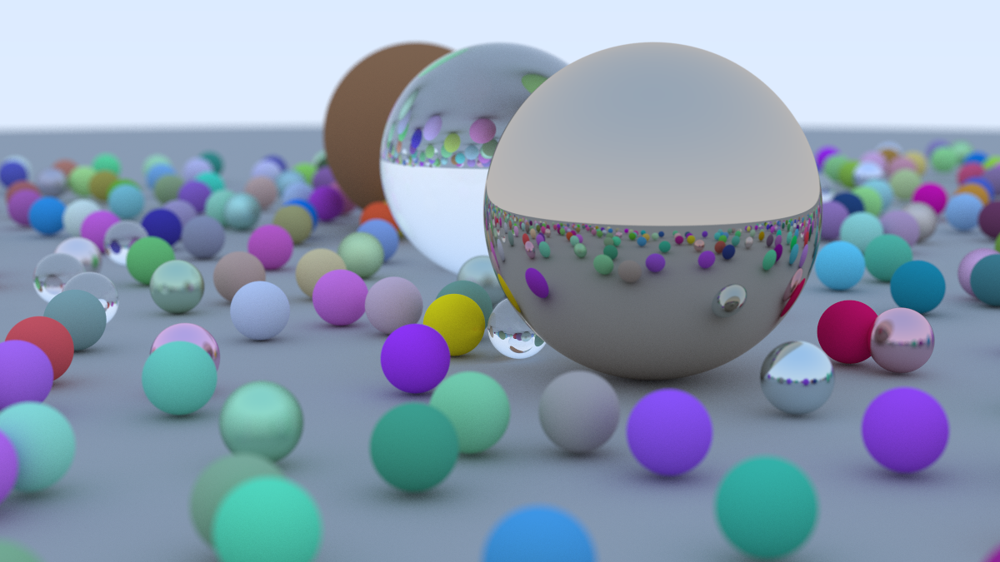

# Ray Tracing in One Weekend

A Rust implementation of [*Ray Tracing in One Weekend*](https://raytracing.github.io/books/RayTracingInOneWeekend.html)
by Peter Shirley, Trevor David Black and Steve Hollasch - book 1 of the series.



## Running it

```
cargo run --release -- out.ppm
```

## Performance

The pixel loop is parallelized across scanlines with [rayon](https://github.com/rayon-rs/rayon).
Measured on an AMD Ryzen 9 7900X (12 cores / 24 threads, `performance` governor,
boost enabled) at 1200 x 675, 500 samples per pixel, max depth 50. Release build,
stock profile, wall clock.

| threads | time | speedup | efficiency per core |
| ---: | ---: | ---: | ---: |
| 1 | 1184.6 s | 1.00x | 100% |
| 2 | 599.5 s | 1.98x | 99% |
| 4 | 306.2 s | 3.87x | 97% |
| 6 | 206.2 s | 5.75x | 96% |
| 8 | 156.8 s | 7.56x | 94% |
| 12 | 108.0 s | 10.97x | 91% |
| 16 | 97.7 s | 12.13x | SMT |
| 24 | 85.0 s | 13.94x | SMT |
